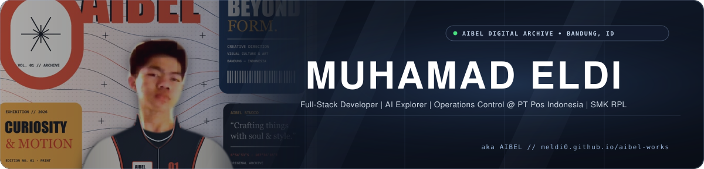
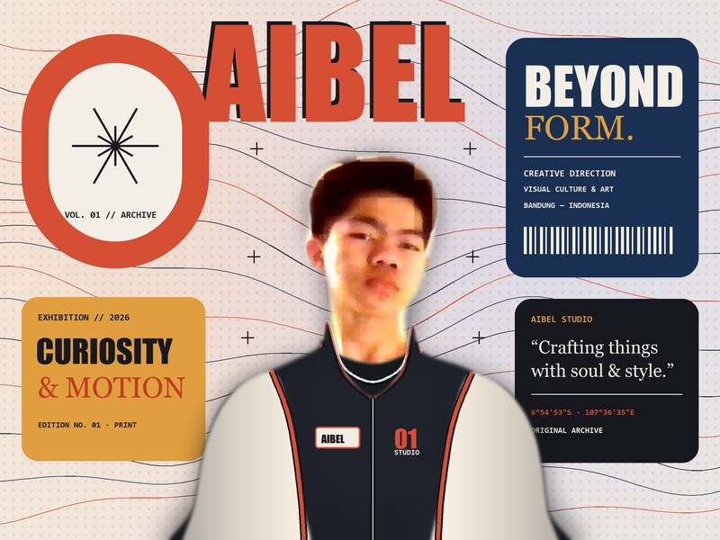
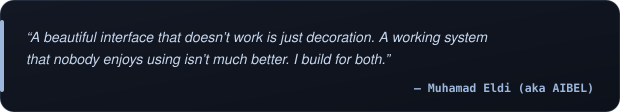
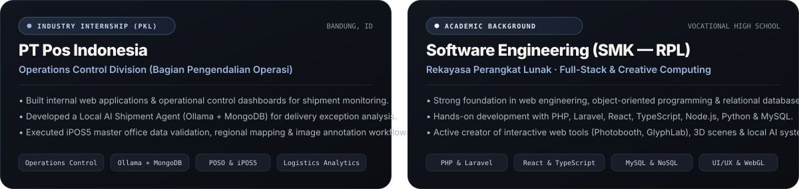
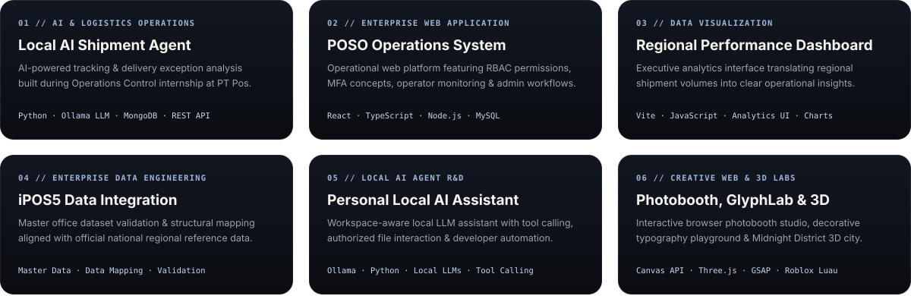

<div align="center">
  <a href="https://meldi0.github.io/aibel-works/">
    
  </a>
</div>

<br />

## About Me



```ts
const AIBEL = {
  name: "Muhamad Eldi (aka AIBEL)",
  education: "SMK — Software Engineering (Rekayasa Perangkat Lunak / RPL)",
  internship: "PT Pos Indonesia — Operations Control (Pengendalian Operasi)",
  location: "Bandung, West Java, Indonesia",

  building: [
    "Full-Stack Web & Enterprise Systems",
    "Local AI Agents & Ollama Workflows",
    "Logistics Dashboards & Creative Web Tools"
  ],

  exploring: [
    "Local LLMs & Autonomous Tool Calling",
    "Interactive 3D WebGL & GSAP Motion",
    "Enterprise Data Mapping (POSO & iPOS5)"
  ],

  tech: {
    frontend: ["React", "TypeScript", "JavaScript", "TailwindCSS", "Three.js", "GSAP"],
    backend: ["PHP", "Laravel", "Node.js", "Python", "REST API"],
    ai_and_data: ["Ollama Local LLM", "MongoDB", "MySQL", "Logistics Analytics"]
  }
};
```

<a href="https://meldi0.github.io/aibel-works/">
  
</a>

<br clear="both" />
<br />

## Connect With Me

<div align="center">
  <a href="https://meldi0.github.io/aibel-works/">
    
  </a>
  &nbsp;
  <a href="mailto:muheldinug122@gmail.com">
    
  </a>
  &nbsp;
  <a href="https://github.com/Meldi0/aibel-works">
    
  </a>
  &nbsp;
  <a href="https://meldi0.github.io/aibel-works/#contact">
    
  </a>
</div>

<br />

## Tech Stack

<div align="center">
  <a href="https://meldi0.github.io/aibel-works/#stack">
    
  </a>
  <br /><br />
  
  
  
  
  
  <br />
  
  
  
  
</div>

<br />

## Experience & Selected Works

<div align="center">
  <a href="https://meldi0.github.io/aibel-works/#experience">
    
  </a>
  <br /><br />
  <a href="https://meldi0.github.io/aibel-works/#projects">
    
  </a>
</div>

<br />

## GitHub Analytics

<div align="center">
  
  <br />
  
  
  <br />
  
  
</div>

<br />

## GitHub Trophies

<div align="center">
  
</div>

<br />

---

<div align="center">
  <sub><strong>Muhamad Eldi (aka AIBEL)</strong> &nbsp;·&nbsp; SMK Software Engineering (RPL) &nbsp;·&nbsp; PT Pos Indonesia (Operations Control) &nbsp;·&nbsp; <a href="https://meldi0.github.io/aibel-works/"><strong>meldi0.github.io/aibel-works</strong></a></sub>
</div>
