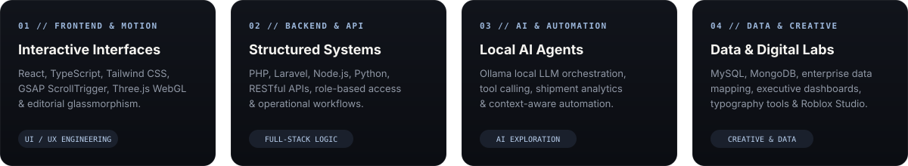

  
   
   
  

    
    &nbsp;&nbsp;
    
    &nbsp;&nbsp;
    
  

 

### `01` &nbsp;Overview

I’m **Muhamad Eldi** (also known as **AIBEL**), a student developer and **Software Development, Data & AI Intern at PT Graha Pos Indonesia (2026)** based in **Bandung, Indonesia**.

I enjoy building things from scratch, understanding how systems work behind the scenes, and crafting digital experiences where **clean visual design** meets **structured backend architecture** and **practical AI workflows**.

- **Core Focus:** Full-Stack Web Development, Local AI Agents (`Ollama` + `MongoDB`), Data Dashboards, and Interactive Web Experiences.
- **Interactive Portfolio:** [**meldi0.github.io/aibel-works**](https://meldi0.github.io/aibel-works/)

 

### `02` &nbsp;Engineering Pillars

  

 

### `03` &nbsp;Selected Works & R&D Index

| ID | Project / System | Domain & Focus | Key Stack |
| :--- | :--- | :--- | :--- |
| **`01`** | [**Local AI Shipment Agent**](https://meldi0.github.io/aibel-works/#projects) | Logistics Tracking & Exception Analysis via Local LLM | `Python` `Ollama` `MongoDB` `REST API` |
| **`02`** | [**Personal Local AI Assistant**](https://meldi0.github.io/aibel-works/#projects) | Workspace-Aware Local AI Agent & Tool Calling | `Python` `Ollama` `Local LLMs` `Web UI` |
| **`03`** | [**POSO Enterprise System**](https://meldi0.github.io/aibel-works/#projects) | Operational Web Application, RBAC & Admin Workflows | `React` `TypeScript` `Node.js` `MySQL` |
| **`04`** | [**Regional Performance Dashboard**](https://meldi0.github.io/aibel-works/#projects) | Executive Logistics Visualization & Volume Analytics | `Vite` `JavaScript` `Data Visualization` |
| **`05`** | [**iPOS5 Data Integration**](https://meldi0.github.io/aibel-works/#projects) | Master Office Data Validation & Regional Reference Mapping | `Data Mapping` `Validation` `Enterprise Data` |
| **`06`** | [**Photobooth Web Studio**](https://meldi0.github.io/aibel-works/#projects) | Browser Camera Capture, Custom Frames & Instant Strip Export | `JavaScript` `HTML5 Canvas` `MediaDevices` |
| **`07`** | [**GlyphLab Typography Studio**](https://meldi0.github.io/aibel-works/#projects) | Interactive Decorative Font Pairing & Visual Style Playground | `HTML5` `CSS3` `JavaScript` `Creative UI` |
| **`08`** | [**Midnight District**](https://meldi0.github.io/aibel-works/#projects) | Atmospheric 3D Urban Environment & Interactive Architecture | `Roblox Studio` `Luau` `3D World Building` |

 

### `04` &nbsp;Technical Toolkit

  
  
  
  
  
  
  
  
  
  
  
  
  
  
  
  

 

---

  <strong>Muhamad Eldi (aka AIBEL)</strong> &nbsp;•&nbsp; <em>Still learning. Still shipping. Still curious.</em>

